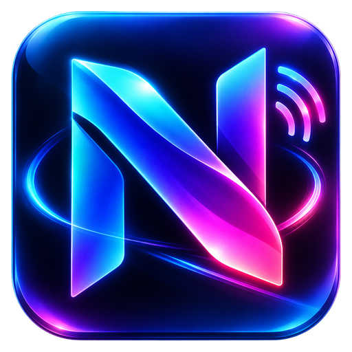
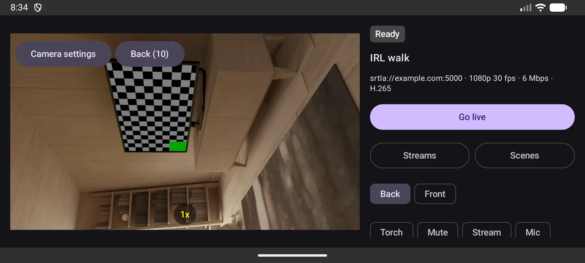

<div align="center">



# NexusIRL

**Free, open-source IRL live streaming for Android.**<br>
Bond mobile data, Wi-Fi and a second phone into one stream that stays live when a network fades.

[](https://github.com/mesmerize08/NexusIRL/actions/workflows/ci.yml)
[](https://github.com/mesmerize08/NexusIRL/releases)
[](LICENSE)


[**Download**](https://github.com/mesmerize08/NexusIRL/releases) ·
[Website](https://mesmerize08.github.io/NexusIRL/) ·
[Guides](#documentation) ·
[What's new](CHANGELOG.md)



</div>

NexusIRL is an Android port of [Moblin](https://github.com/eerimoq/moblin), the IRL streaming app
for iPhone. It uses the same protocols and settings files, so it works with iOS Moblin's settings,
remote control and Moblink relays. It has no accounts, ads, analytics or tracking, needs no server
run by its developers, and keeps your stream keys encrypted on your phone.

> [!NOTE]
> **Early test releases (0.x).** Streaming, scenes, recording, chat, the chat bot and remote
> control are tested on real phones, live on Twitch and Kick, and alongside iOS Moblin. Bonding
> over real mobile networks, Moblink between phones and sessions longer than an hour are still
> being field tested. See [tested devices](#tested-devices).

> [!IMPORTANT]
> **Built with generative AI.** Most of NexusIRL's code is written by an AI coding assistant and
> reviewed by the maintainer; see [how it is made](#how-it-is-made). Not affiliated with or
> endorsed by the Moblin project.

## Features

| Area | What works today |
|---|---|
| **Streaming** | SRT with AES encryption, SRTLA bonding (mobile data, Wi-Fi, Ethernet and Moblink relays, with per-connection priorities), RTMP and RTMPS including enhanced RTMP for HEVC. H.264 or H.265 video up to 4K, AAC or Opus audio. One RTMP stream to several servers at once (for example Twitch and YouTube). |
| **Adaptive bitrate** | Moblin's IRL algorithms (fast and slow) and BELABOX's, driven by the network. |
| **Recording** | MP4 recording while streaming or on its own, and snapshots, saved on the phone or uploaded to Discord. |
| **Camera** | All back and front lenses, zoom presets, tap to focus, manual focus, exposure, ISO and white balance, torch with brightness, stabilization, portrait and landscape streams. Comes back by itself when another app has taken the camera. |
| **Scenes and widgets** | Scenes with text (timers, location, speed), image, QR code, map, chat and browser widgets; LUTs and effects. |
| **Chat and alerts** | Twitch, Kick and YouTube chat with BTTV, FFZ and 7TV emotes. Twitch alerts (follows, subs, raids, cheers, rewards) and Kick alerts (subs, gifts, rewards, hosts, Kicks) on screen and in chat. Signed in to Twitch or Kick: send messages and change the stream title and category. |
| **Chat bot** | Moblin's `!moblin` commands from Twitch and Kick chat: scenes, mute, zoom, torch, effects, snapshots, start and stop, title and category, with Moblin's permissions, cooldowns and aliases. See the [chat bot guide](docs/chat-bot.md). |
| **OBS remote control** | Switch OBS scenes, start and stop OBS, and show a BRB scene automatically while the phone's stream reconnects. |
| **Remote control** | Control the phone from iOS Moblin, another Android phone or a browser (protected by an access link), on the same Wi-Fi, over Tailscale or through [your own relay](server/relay/README.md). |
| **Moblink** | Lend this phone's mobile data to a Moblin or NexusIRL streamer, or bond other phones' data into your stream. |
| **Settings** | Import and export iOS Moblin `.moblinSettings` files and `moblin://` setup links, always with a confirmation. |
| **Privacy and security** | Stream keys and tokens encrypted with a hardware-backed key and kept out of logs, screenshots and plain exports; local control servers off by default; **Share diagnostics** for bug reports without secrets. |

Not ported yet: ingest servers (RTMP, SRT and RIST input), WHIP, face and background effects,
VTuber widgets and YouTube sign-in. The [port plan](docs/PORT_PLAN.md) lists everything with its
status.

**Known limitation:** a recording becomes playable only when recording stops normally. If the app
is closed by force, crashes or the battery runs out while recording, that recording is lost (the
stream itself is not affected). Crash-safe recording is planned.

## Install

1. Open the newest release on the [Releases](https://github.com/mesmerize08/NexusIRL/releases) page
   and download the APK for your phone:
   - `NexusIRL-v<version>-arm64-v8a.apk`: practically every phone from the last several years
   - `armeabi-v7a`: older 32-bit phones
   - `x86_64`: Chromebooks and emulators
   - `universal`: if unsure
2. Optionally check it against `SHA256SUMS` from the same release.
3. Open it on the phone and allow your browser or file manager to install apps when Android asks.

Android 10 or newer is needed. Updates install over the previous version and keep your settings.
[Obtainium](https://github.com/ImranR98/Obtainium) can follow the releases for you.

**F-Droid:** planned for January 2027, once the project meets F-Droid's three-month rule. F-Droid's
builds already match these APKs byte for byte, so you will be able to switch between the two
without reinstalling.

<details>
<summary>Signing certificate</summary>

Release APKs are signed with this certificate (SHA-256), as shown by
`apksigner verify --print-certs`:

```
00179e11f876bea2cf2189b9c04c91190cb58c6e17f56c7792e989a0038e6329
```

</details>

## Tested devices

| Phone | Android | Tested |
|---|---|---|
| Samsung Galaxy S26 Ultra (Snapdragon) | 17 | Live on Twitch over RTMPS; Twitch and Kick chat, sign-in, chat bot and title changes; 60-minute SRTLA soak without drift or gaps; SRTLA bonding with an iPhone Moblink relay; Moblin's recording tests in six formats up to 4K and 1080p60; recovery when another app takes the camera; both orientations; remote control from iOS Moblin |
| Huawei P30 Pro (Kirin 980) | 10 | Install and update from the published APKs; settings import from iOS Moblin; 1080p30 H.265 stream |
| Android emulator | 14 and 16 | UI tests on every change; Moblin's system-test harness |

Moblin's own system-test harness runs against NexusIRL too; see
[tools/moblin-harness](tools/moblin-harness/README.md) for what passes.

**Have a different phone?** Reports from other phones are the most useful help: see the
[short checklist](docs/testing/community-testing.md) and the device test report form.

## Documentation

| For | Document |
|---|---|
| Remote control (browser, Tailscale, relay) | [docs/remote-control.md](docs/remote-control.md) |
| Chat bot (`!moblin` commands) | [docs/chat-bot.md](docs/chat-bot.md) |
| Field testing bonding away from home | [docs/testing/field-test.md](docs/testing/field-test.md) |
| Privacy | [docs/privacy-policy.md](docs/privacy-policy.md) |
| Security design and reporting | [docs/threat-model.md](docs/threat-model.md), [SECURITY.md](SECURITY.md) |
| Release audit | [docs/audit](docs/audit/README.md) |
| Plan, phases and decisions | [docs/PORT_PLAN.md](docs/PORT_PLAN.md) |
| Upstream file mapping | [docs/PORTING.md](docs/PORTING.md) |
| Releases and dependency updates | [docs/RELEASING.md](docs/RELEASING.md), [CHANGELOG.md](CHANGELOG.md) |
| Contributing | [CONTRIBUTING.md](CONTRIBUTING.md) |

## How it is made

NexusIRL is developed with generative AI: most of its code, tests and documentation are written by
an AI coding assistant (Anthropic's Claude), directed and reviewed by the maintainer. Because of
that, the project leans on checks that do not depend on trusting the code's author:

- Each ported file follows a named Moblin source file, and Moblin's own tests are ported as
  golden tests, so behaviour can be compared with the original.
- Every change runs the unit tests, lint, a licence check, a secret scan, CodeQL and UI tests on
  an emulator, and releases are built only from commits that passed them.
- Streaming is checked against real servers (mediamtx, ffmpeg, an SRTLA receiver), against iOS
  Moblin, and in field tests on real phones and mobile networks.
- Release builds are reproducible, so anyone can confirm an APK was built from this source.
- A [release-readiness audit](docs/audit/README.md) by a different AI system (OpenAI's ChatGPT)
  was checked against the code and its findings fixed in v0.5.0.

If you find something wrong, please [open an issue](https://github.com/mesmerize08/NexusIRL/issues).

## Build from source

Requirements: JDK 17, the Android SDK (platform 37) and Git.

```sh
git clone --recurse-submodules https://github.com/mesmerize08/NexusIRL.git
cd NexusIRL
./gradlew test assembleDebug          # unit tests and a debug APK
./gradlew installDebug                # install on a connected phone
```

The full check that CI runs on every change:

```sh
./gradlew ktlintCheck test lint :app:licensee assembleDebug assembleRelease
sh tools/check-independence.sh
```

Unit tests include interoperability tests against reference implementations (libsrt and an RTMP
server through ffmpeg); they run when `ffmpeg` is on the `PATH` and are skipped otherwise. CI
installs ffmpeg and sets `NEXUSIRL_REQUIRE_FFMPEG=1`, so there they always run. Every dependency
is pinned by checksum in `gradle/verification-metadata.xml`, and every GitHub Action by commit.

<details>
<summary>Project structure</summary>

| Path | Contents |
|---|---|
| `app/` | The Android app: Jetpack Compose UI, stream session, controllers |
| `media/pipeline/` | Camera2 capture, OpenGL compositor and frame timer, MediaCodec encoders, MP4 recording |
| `media/mux/` | MPEG-TS muxer, FLV/AMF0, NAL and SEI utilities |
| `transport/srt/` | Moblin's SRT sender with AES encryption, SRTLA client and server |
| `transport/rtmp/` | RTMP and RTMPS client with enhanced RTMP |
| `transport/abr/` | Adaptive bitrate algorithms |
| `effects/` | Scene effects and widget rendering |
| `settings/` | iOS-compatible settings document, import and export, setup links |
| `chat/` | Twitch, Kick and YouTube chat, Twitch sign-in, alerts, and the Twitch and Kick APIs |
| `obs/` | OBS WebSocket remote control |
| `remotecontrol/` | Moblin remote control protocol: streamer, assistant and web remote control |
| `moblink/` | Moblink protocol: relay and streamer |
| `net/` | Multi-network handling for bonding |
| `core/` | Swift-compatible JSON, clocks, secret storage and redaction, WebSockets |
| `server/` | Self-hosted remote control relay and an SRTLA test receiver |
| `tools/` | Desktop streaming CLI (`push`), SRTLA test receiver, Moblin harness runner, device checks |
| `upstream/` | Moblin's source as a pinned submodule: reference, test vectors and system tests |

</details>

## Contributing and support

Bug reports and pull requests are welcome; please read [CONTRIBUTING.md](CONTRIBUTING.md) first.
For a bug report, tap **Share diagnostics** at the bottom of the main screen and attach the file:
it contains no stream keys, passwords or tokens. Report security problems privately as described
in [SECURITY.md](SECURITY.md).

## Credits and license

NexusIRL is MIT licensed; see [LICENSE](LICENSE). It contains code ported from
[Moblin](https://github.com/eerimoq/moblin), © 2023 Erik Moqvist, under the MIT License; see
[NOTICE](NOTICE). Each ported file names its upstream source, and [docs/PORTING.md](docs/PORTING.md)
tracks the mapping. Thanks to the Moblin project, whose design, protocols and tests made this port
possible.

The website uses the [Archivo](https://github.com/Omnibus-Type/Archivo) typeface under the SIL Open
Font License.
