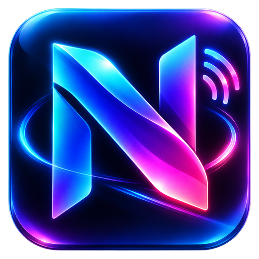

# NexusIRL

A free, open-source IRL live-streaming app for Android, ported from
[Moblin](https://github.com/eerimoq/moblin) (iOS, MIT License).

> **Status: early development.** The app streams camera and microphone over SRT (with AES
> encryption), SRTLA bonding and RTMP(S), with adaptive bitrate, HEVC, automatic reconnect and
> mic selection. This is verified on the Android emulator; testing on real phones, settings,
> scenes, chat and remote control are still to come. See [docs/PORT_PLAN.md](docs/PORT_PLAN.md)
> for the full plan and phase gates.
>
> Privacy policy: [docs/privacy-policy.md](docs/privacy-policy.md).

**Not affiliated with or endorsed by the Moblin project.**

## Goals

- **Core IRL streaming:**
  - SRT, SRTLA bonding (cellular + Wi-Fi + Ethernet) and RTMP(S)
  - adaptive bitrate
  - scenes and widgets
  - Twitch, Kick and YouTube chat
- **Wire-compatible with iOS Moblin:** import `.moblinSettings`, interoperate with Moblin remote
  control and Moblink relays.
- **Independent:** works without any service run by the Moblin author or by this project. Any
  remote-control relay is self-hosted (see the plan, §8).
- **FOSS-clean:** no Google Play Services, Firebase or analytics, so it is eligible for F-Droid and
  works on de-Googled phones.
- **Secure by default:**
  - stream keys and tokens are encrypted with an Android Keystore-backed key
  - secrets are redacted from logs
  - local control servers are off by default and authenticated (see the plan, §9)

## Repository layout

| Path | Contents |
|---|---|
| `app/` | Android app (Jetpack Compose) |
| `core/codable/` | Swift-`Codable`-compatible JSON for wire compatibility with iOS Moblin |
| `core/clock/` | Host clock, `MediaTime` and timestamp helpers |
| `core/secrets/` | `SecretStore` (Keystore + Tink) and `Redactor` |
| `media/mux/` | MPEG-TS muxer (H.264/HEVC, AAC/Opus), NAL and SEI utilities |
| `transport/srt/` | Moblin's SRT sender with AES encryption, SRTLA bonding client and relay server, ABR driver |
| `transport/rtmp/` | RTMP/RTMPS client with enhanced RTMP (HEVC, Opus) |
| `transport/abr/` | Adaptive bitrate algorithms (SrtFight "IRL" and BELABOX) |
| `tools/push/` | Desktop CLI that streams a file with the same transports |
| `upstream/` | Moblin source as a git submodule, pinned for reference, test vectors and the system-test harness |
| `docs/` | Port plan, threat model, porting tracker |

## Building

Requirements: JDK 17 and the Android SDK (platform 36).

```sh
git clone --recurse-submodules <this repo>
./gradlew test assembleDebug
```

### Desktop streaming tool

`tools/push` streams any media file with the app's own transports, which is handy for testing an
ingest server before the Android pipeline exists. It needs ffmpeg on the PATH.

```sh
./gradlew :tools:push:installDist
tools/push/build/install/push/bin/push --input clip.mp4 --url "srt://host:port?streamid=...&passphrase=..."
tools/push/build/install/push/bin/push --input clip.mp4 --url rtmp://host/app/key
```

It prints live statistics (RTT, packets in flight, send rate, retransmissions and the bitrate the
adaptive algorithm requests). Stream keys and passphrases are never printed.

### Tests

`./gradlew test` runs the unit tests. Interop tests check the transports against real reference
implementations (libsrt and the RTMP server via ffmpeg) and run when `ffmpeg` is installed; they are
skipped otherwise.

## Credits and license

MIT, see [LICENSE](LICENSE). This project contains code ported from Moblin, © 2023 Erik Moqvist,
under the MIT License; see [NOTICE](NOTICE). Every ported file names its upstream source in a
header comment, and [docs/PORTING.md](docs/PORTING.md) tracks the mapping.

Security issues: see [SECURITY.md](SECURITY.md).
